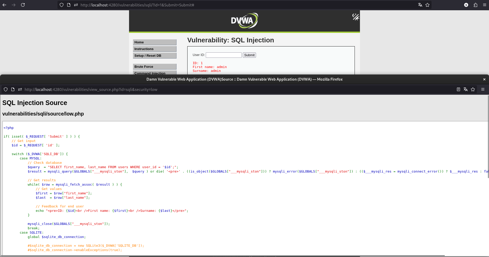
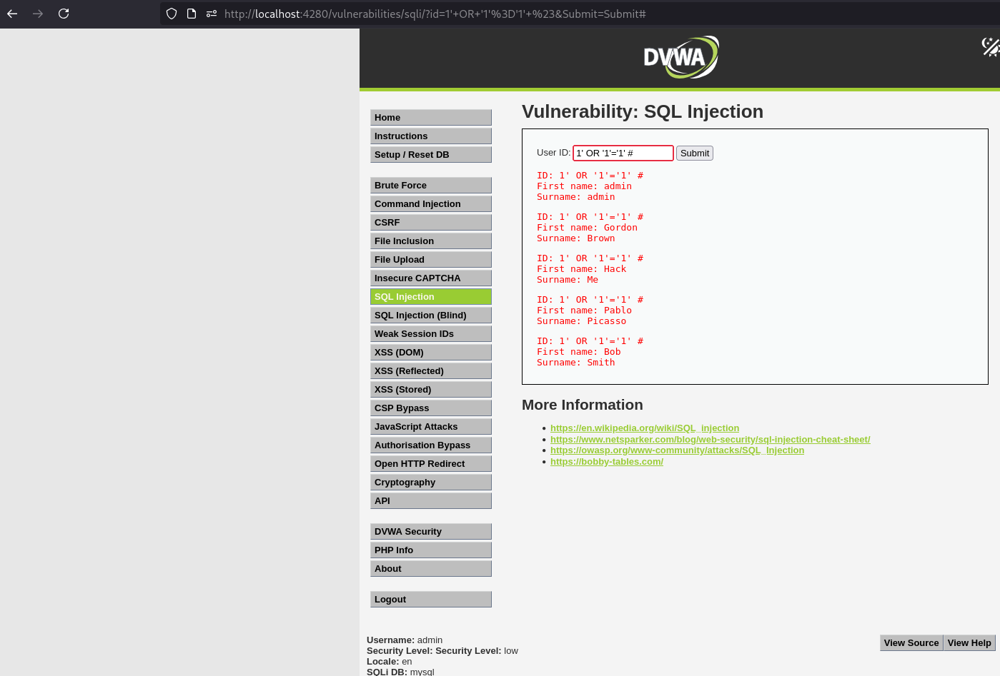
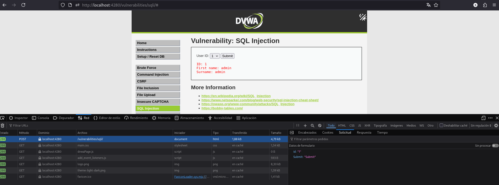
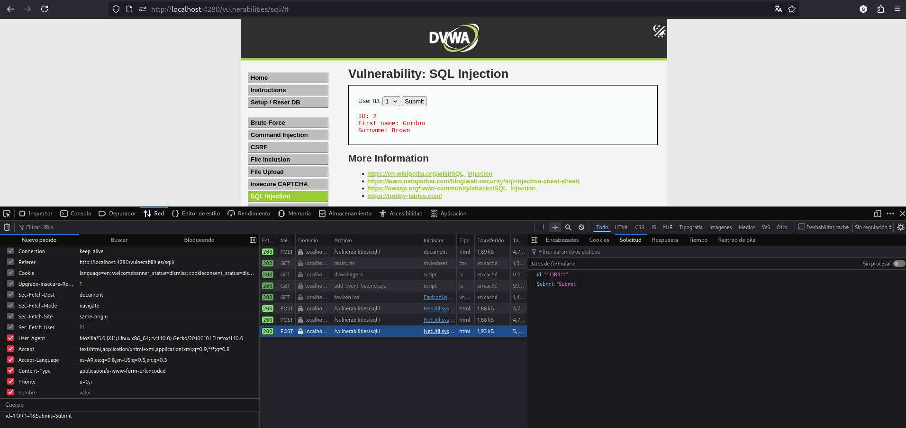
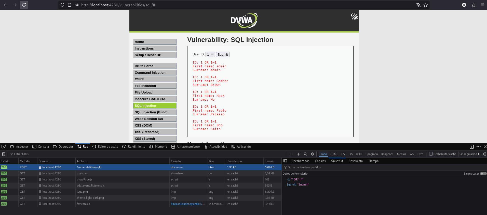
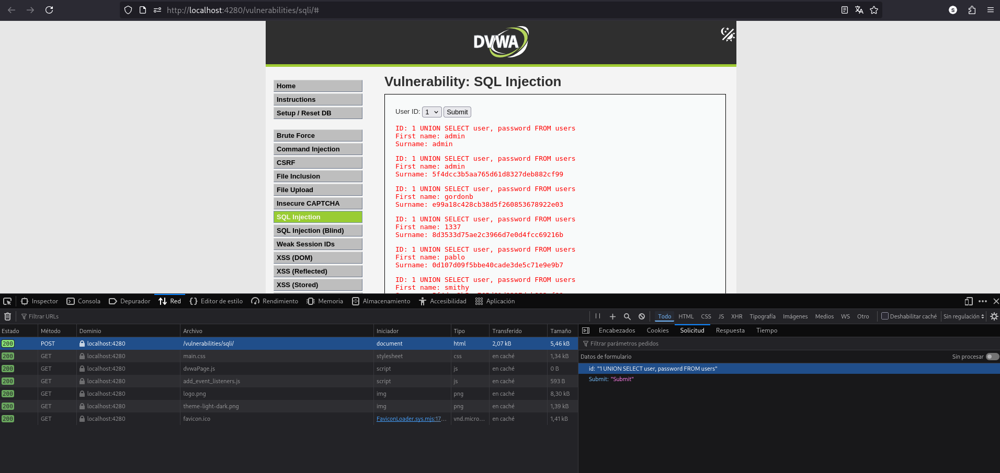
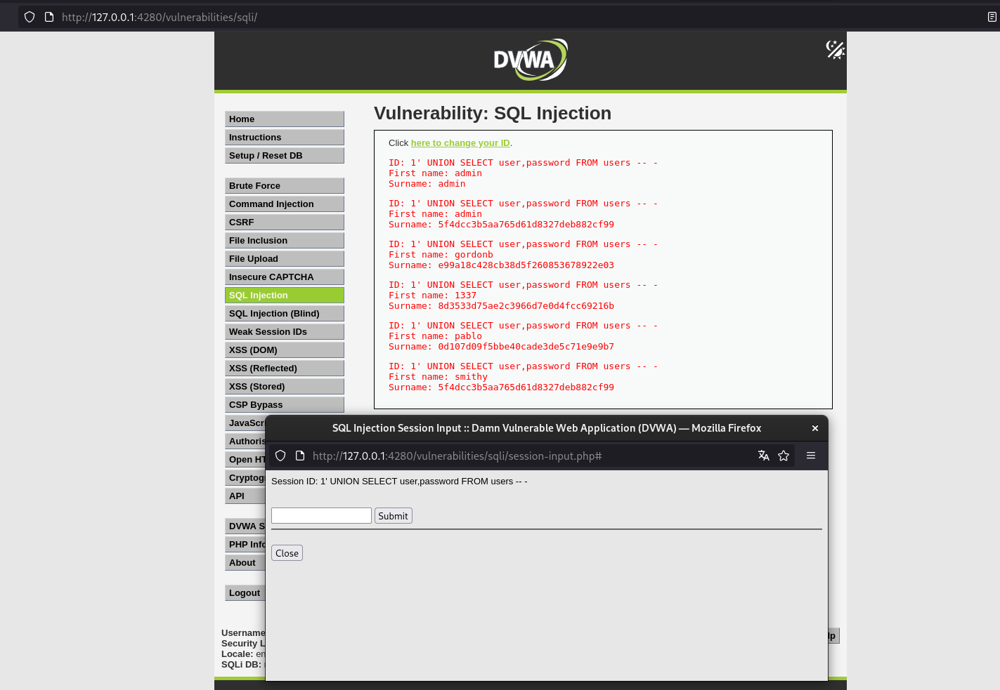
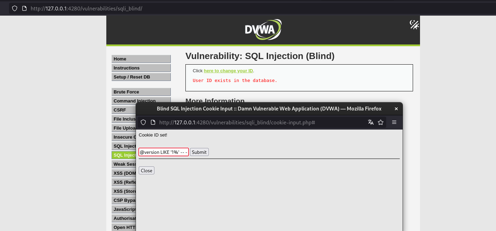
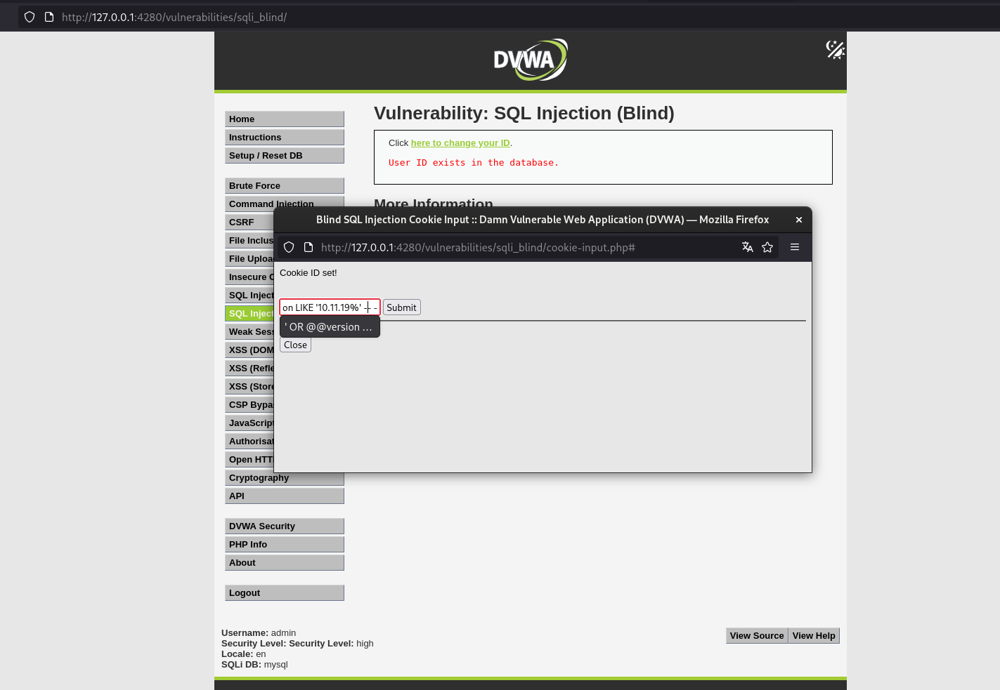

# Vulnerabilidades de DVWA

## Tabla de Contenidos
- [SQL Injection - Low](#sql-injection---low)
- [SQL Injection - Medium](#sql-injection---medium)
- [SQL Injection - UNION-based - Medium](#sql-injection---union-based---medium)
- [SQL Injection - UNION-based - High](#sql-injection---union-based---high)
- [SQL Injection (Blind) - High](#sql-injection-blind---high)
- [Remediación en PHP y MySQL](#remediación-en-php-y-mysql)

---

## SQL Injection - Low

**Categoría OWASP:** A03:2021 – Injection

**Descripción:** Manipular la consulta SQL del módulo de SQL Injection para obtener información de múltiples usuarios.

**Análisis**

Primero probé el funcionamiento normal introduciendo:

```text
1
```

La aplicación devolvió los datos correspondientes al usuario con id = 1.



Al revisar el código fuente, la consulta utilizada por la aplicación es:

```sql
SELECT first_name, last_name FROM users WHERE user_id = '$id';
```

El problema es que el valor ingresado por el usuario se concatena directamente dentro de la consulta SQL sin ningún tipo de validación ni parametrización.

**Payload / exploit**

Utilicé el siguiente payload:

```text
1' OR '1'='1' #
```

El payload cierra la comilla del parámetro `id`, agrega una condición que siempre da verdadero (`'1'='1'`) y usa `#` para comentar el resto de la consulta original. Como resultado, la condición `WHERE` se cumple en todas las filas y la aplicación devuelve todos los usuarios de la base de datos.



**Resultado**

Fue posible modificar la consulta y volcar la información de todos los usuarios registrados.

**Mitigación**

Implementar **consultas preparadas (Prepared Statements)**. Al preparar la consulta, la base de datos separa la estructura SQL del valor del usuario, tratando la entrada estrictamente como un dato y no como código ejecutable. *(Ver ejemplos de código al final).*

**Referencia:** [OWASP Top 10:2021 – A03: Injection](https://owasp.org/Top10/A03_2021-Injection/)

---

## SQL Injection - Medium

**Categoría OWASP:** A03:2021 – Injection

**Descripción:** Explotar la protección implementada en el nivel Medium para obtener información de múltiples usuarios.

**Análisis**

A diferencia de Low, el formulario utiliza un menú desplegable y envía el parámetro mediante `POST`. Además, el código fuente muestra que aplica `mysqli_real_escape_string()` sobre el valor recibido.

La petición manda el `id` junto con un string `Submit` que podemos interceptar y modificar en Burp Suite:



Sin embargo, al mirar cómo se construye la consulta en el servidor:

```sql
SELECT first_name, last_name FROM users WHERE user_id = $id;
```

**Por qué falló la protección:** En este nivel, el parámetro `$id` no está entre comillas en la consulta. La función `mysqli_real_escape_string()` está diseñada para escapar caracteres delimitadores de strings (como comillas simples o dobles), pero **no previene inyecciones en campos numéricos**. Como el payload que necesitamos inyectar no lleva comillas, la función de escape no hace nada y la expresión se ejecuta directamente.

**Payload / exploit**

Modifiqué la petición POST para enviar:

```text
1 OR 1=1
```



La consulta resultante queda:

```sql
SELECT first_name, last_name
FROM users
WHERE user_id = 1 OR 1=1;
```

Como `1=1` siempre es verdadero, la aplicación devolvió los datos de los cinco usuarios.

**Resultado**

Fue posible alterar la condición `WHERE` y obtener los datos de todos los usuarios sin necesitar comillas ni caracteres especiales.



**Mitigación**

No confiar en funciones de escape de strings para proteger campos numéricos. Para este caso:
1. Usar **Prepared Statements** vinculando el parámetro como tipo entero.
2. Hacer un casteo explícito en PHP con `(int)$_POST['id']` antes de usar el valor.

**Referencia:** [OWASP Top 10:2021 – A03: Injection](https://owasp.org/Top10/A03_2021-Injection/)

---

## SQL Injection - UNION-based - Medium

**Categoría OWASP:** A03:2021 – Injection

**Descripción:** Utilizar una inyección basada en `UNION` para obtener datos de otras columnas de la tabla `users`.

**Análisis**

Una vez confirmada la inyección numérica en este nivel, utilicé `UNION SELECT` para consultar datos adicionales de la base de datos.

Para que una consulta `UNION` funcione, debe devolver el mismo número de columnas que la consulta original. Como la consulta original devuelve dos columnas (`first_name` y `last_name`), el `UNION` también debe pedir exactamente dos columnas.

**Payload / exploit**

Utilicé:

```sql
1 UNION SELECT user, password FROM users
```

La consulta resultante queda conceptualmente como:

```sql
SELECT first_name, last_name
FROM users
WHERE user_id = 1
UNION
SELECT user, password FROM users;
```

De esta forma, en el campo de `First name` la aplicación muestra el nombre de usuario (`user`) y en `Surname` muestra la contraseña almacenada (`password`).



**Resultado**

Fue posible extraer los nombres de usuario y los hashes de contraseñas de los cinco usuarios de la base de datos dentro de la misma respuesta.

**Mitigación**

Al utilizar consultas preparadas, la base de datos compila la estructura de la consulta de antemano. Lo que el usuario ingrese se procesa únicamente como el valor de búsqueda, impidiendo que el operador `UNION` sea interpretado como una instrucción SQL.

**Referencia:** [OWASP Top 10:2021 – A03: Injection](https://owasp.org/Top10/A03_2021-Injection/)

---

## SQL Injection - UNION-based - High

**Categoría OWASP:** A03:2021 – Injection

**Descripción:** Explotar la SQL Injection del nivel High para obtener las contraseñas de los usuarios superando intermediaciones de sesión y la cláusula `LIMIT 1`.

**Objetivo**

El apartado **Help** indica que existen cinco usuarios en la base de datos y que el objetivo es obtener sus contraseñas mediante SQL Injection.

**Análisis**

En este nivel, el valor ingresado se envía primero a una ventana secundaria (`session-input.php`) que almacena el input en la sesión del usuario (`$_SESSION['id']`). Después, `high.php` toma ese valor de la sesión para ejecutar la consulta:

```sql
SELECT first_name, last_name
FROM users
WHERE user_id = '$id'
LIMIT 1;
```

**Dos puntos clave de este nivel:**
1. **Guardar en sesión no sanitiza:** Guardar el dato temporalmente en `$_SESSION` no limpia el input. Como el valor sigue concatenándose directamente en la consulta, la vulnerabilidad sigue estando ahí.
2. **Eliminar el `LIMIT 1`:** La consulta intenta limitar el resultado a una sola fila con `LIMIT 1`. Pero como controlamos lo que va en `$id`, podemos usar un comentario (`-- -`) para descartar el resto de la consulta y anular ese límite.

**Payload / exploit**

Utilicé el siguiente payload:

```text
1' UNION SELECT user,password FROM users -- -
```

La consulta ejecutada en la base de datos queda:

```sql
SELECT first_name, last_name
FROM users
WHERE user_id = '1'
UNION
SELECT user,password FROM users
-- - LIMIT 1;
```

Al comentar el `LIMIT 1`, el `UNION SELECT` devuelve todas las filas con los usuarios y contraseñas.



**Resultado**

Fue posible obtener los cinco nombres de usuario y las contraseñas almacenadas en la base de datos, cumpliendo el objetivo del ejercicio.

**Mitigación**

Cualquier dato que termine en una consulta SQL debe parametrizarse en el punto de ejecución, sin importar si viene de una petición GET, POST o de una variable de sesión.

**Referencia:** [OWASP Top 10:2021 – A03: Injection](https://owasp.org/Top10/A03_2021-Injection/)

---

## SQL Injection (Blind) - High

**Categoría OWASP:** A03:2021 – Injection

**Descripción:** Utilizar una Blind SQL Injection booleana para inferir y extraer la versión exacta del software de base de datos mediante respuestas de tipo verdadero/falso.

**Objetivo**

El apartado **Help** indica que el objetivo es identificar la versión del software de base de datos mediante Blind SQL Injection.

**Análisis**

A diferencia de los niveles anteriores, la aplicación no muestra datos de la tabla ni mensajes de error de SQL en pantalla. En su lugar, toma el valor de la cookie `id` y solamente nos dice:

- Si la consulta encuentra al menos un resultado:
  ```text
  User ID exists in the database.
  ```
- Si la consulta no encuentra resultados:
  ```text
  User ID is MISSING from the database.
  ```

Esto nos da un oráculo de verdadero o falso: podemos hacer preguntas lógicas a la base de datos y deducir las respuestas según si la aplicación dice que el usuario existe o no.

**Payload / exploit**

Primero comprobé este comportamiento probando condiciones básicas conocidas como verdaderas y falsas (`' OR '1'='1` vs `' OR '1'='2`) para confirmar que la respuesta de la aplicación servía como indicador.

Luego utilicé la variable `@@version` de MySQL/MariaDB y empecé a hacer preguntas usando el operador `LIKE`:

```text
' OR @@version LIKE '1%' -- -
```

La respuesta fue `User ID exists`, indicando que la versión efectivamente empieza con `1`.



A partir de ahí, fui probando carácter por carácter:

```text
10 -> exist
10. -> exist
10.1 -> exist
10.11 -> exist
10.11. -> exist
10.11.1 -> exist
```

hasta llegar a:

```text
' OR @@version LIKE '10.11.19%' -- -
```

donde la aplicación volvió a responder que el usuario existía.

De esta forma pude reconstruir el prefijo completo de la versión:

```text
10.11.19-
```

La versión identificada fue **MariaDB 10.11.19**.



**Resultado**

Fue posible identificar que el motor de base de datos es **MariaDB 10.11.19** sin que la aplicación mostrara directamente el contenido de `@@version`, únicamente evaluando respuestas de verdadero y falso.

**Mitigación**

Las consultas parametrizadas evitan que las condiciones lógicas inyectadas en la cláusula `WHERE` sean evaluadas por la base de datos, neutralizando la inferencia booleana por completo.

**Referencia:** [OWASP Top 10:2021 – A03: Injection](https://owasp.org/Top10/A03_2021-Injection/)

---

## Remediación en PHP y MySQL

Para solucionar estas vulnerabilidades de raíz en PHP y MySQL, la medida principal es utilizar **consultas preparadas (Prepared Statements)** en lugar de concatenar texto en las sentencias SQL.

### 1. Consultas preparadas con PDO (Recomendado)

Con PDO se puede desactivar la emulación nativa para asegurar que la base de datos reciba los datos de forma separada a la consulta:

```php
<?php
// Conexión con PDO
$pdo = new PDO('mysql:host=localhost;dbname=dvwa;charset=utf8mb4', $db_user, $db_pass, [
    PDO::ATTR_EMULATE_PREPARES   => false,                  // Consultas preparadas reales en el motor
    PDO::ATTR_ERRMODE            => PDO::ERRMODE_EXCEPTION, // Manejo de errores
    PDO::ATTR_DEFAULT_FETCH_MODE => PDO::FETCH_ASSOC
]);

// 1. Definir la consulta con el parámetro nombrado
$stmt = $pdo->prepare('SELECT first_name, last_name FROM users WHERE user_id = :id LIMIT 1');

// 2. Ejecutar pasando el dato
$stmt->execute(['id' => (int)$_POST['id']]);
$user = $stmt->fetch();

if ($user) {
    echo "First name: " . htmlspecialchars($user['first_name'], ENT_QUOTES, 'UTF-8') . "<br>";
    echo "Surname: " . htmlspecialchars($user['last_name'], ENT_QUOTES, 'UTF-8');
} else {
    echo "User ID is MISSING from the database.";
}
?>
```

### 2. Consultas preparadas con MySQLi

Si se utiliza `mysqli`, se utiliza `prepare()` con `bind_param()` especificando el tipo (`i` para números enteros):

```php
<?php
$stmt = $mysqli->prepare('SELECT first_name, last_name FROM users WHERE user_id = ?');

// Vincular estrictamente como entero
$id = (int)$_POST['id'];
$stmt->bind_param('i', $id);

$stmt->execute();
$result = $stmt->get_result();

if ($row = $result->fetch_assoc()) {
    echo "First name: " . htmlspecialchars($row['first_name'], ENT_QUOTES, 'UTF-8') . "<br>";
    echo "Surname: " . htmlspecialchars($row['last_name'], ENT_QUOTES, 'UTF-8');
}
$stmt->close();
?>
```

### Buenas prácticas adicionales:
* **Casteo de tipos:** Si un campo debe ser un número entero, forzar la conversión en PHP con `(int)` antes de procesarlo.
* **Mínimo privilegio:** El usuario de base de datos que usa la web no debería tener permisos de administración ni acceso a tablas internas que no necesite.
* **Ocultar errores en producción:** Asegurarse de que `display_errors` esté desactivado para no filtrar nombres de tablas o versiones del servidor si ocurre un error.
